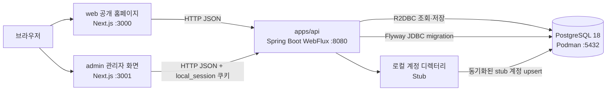

# 로컬 개발·테스트 시스템 아키텍처

> 기준일: 2026-09-29\
> 기준 문서: [요구사항](requirements.md), [API 명세](api-spec.md), [ERD](erd.md)\
> 범위: 로컬 개발 및 테스트 환경만 정의한다. stg/운영 배포, 운영 보안, 가용성, 모니터링 및 실제 DAOU Office 연동 구조는 후속 배포·운영 아키텍처에서 정의한다.

## 1. 설계 원칙

- API(`apps/api`), 공개 홈페이지(`web`), 관리자 화면(`admin`)은 각각 독립 애플리케이션으로 실행한다.
- API는 최신 안정 버전의 Spring Boot 위에서 Kotlin, WebFlux, R2DBC로 작성한 비차단(non-blocking) 애플리케이션이다.
- 로컬에서는 애플리케이션을 호스트에서 실행해 디버깅과 hot reload를 사용하고, PostgreSQL만 Podman 컨테이너로 실행한다. Docker Desktop과 Docker CLI는 사용하지 않는다.
- 애플리케이션과 의존 라이브러리는 기준일의 최신 안정 버전을 사용하고, Gradle 빌드 스크립트와 pnpm workspace catalog·lockfile로 팀 전체의 버전을 일치시킨다.
- DAOU Office 계정 연동은 로컬에서 호출하지 않고 stub 계정 디렉터리로 대체한다.
- UI의 기능 노출 여부와 별개로 API가 요청자의 역할을 검사한다.

## 2. 구성도



## 3. 애플리케이션 책임

| 구성요소 | 책임 | 로컬 실행 방식 |
|---|---|---|
| `apps/api` | 공개 페이지·메뉴 조회, 관리자 인증·역할 검사, 계정 동기화, 콘텐츠 초안·게시·메뉴 API 제공 | JDK 25와 Gradle Wrapper로 실행 |
| `web` | 게시된 콘텐츠와 메뉴를 표시하는 검색 엔진 친화적 공개 홈페이지, 없는 주소의 404 안내 | Next.js 개발 서버 |
| `admin` | stub 계정 로그인·로그아웃, 계정 동기화·검색·역할 관리, 페이지 작성·미리보기·게시, 메뉴 편성 | Next.js 개발 서버 |
| `e2e` | 브라우저에서 관리자 작업부터 공개 홈페이지 반영까지 검증 | Playwright |
| PostgreSQL | 계정, 역할, 동기화 이력, 세션, 콘텐츠 revision, 게시 상태, 메뉴 데이터 저장 | Podman 컨테이너와 로컬 named volume |

`web`과 `admin`은 API를 데이터와 권한의 단일 기준으로 사용한다. 공개 화면은 공개 조회 API만 호출하고, 관리자 동작은 관리자 API를 호출한다. 프런트엔드에서 권한이 없는 메뉴를 감추더라도 서버의 권한 검사를 생략하지 않는다.

## 4. API 및 데이터 흐름

### API 경계

- 공개 API는 `GET /api/public/pages/{slug}`로 게시된 페이지를 반환하고, 없거나 공개되지 않은 slug는 404로 응답한다.
- 공개 API는 `GET /api/public/navigation`으로 게시된 페이지만 포함한 현재 공개 메뉴를 반환한다.
- 관리자 API는 `/api/admin/**` 아래에서 인증·계정·역할·콘텐츠·메뉴 작업을 제공한다.
- 로컬 로그인 및 계정 동기화는 `local` 프로필에서만 stub 공급자를 사용한다.
- 개발 서버의 허용 Origin은 `http://localhost:3000`과 `http://localhost:3001`로 제한하고 credential 요청을 명시적으로 허용한다. 세 애플리케이션이 모두 `localhost`에서 실행되므로 `SameSite=Lax` 세션 쿠키를 사용할 수 있다.

### API 내부 구조

- HTTP 계층은 WebFlux 기반으로 작성하고, 서비스와 저장소는 Kotlin coroutine(`suspend` 함수, `Flow`)으로 Reactor 타입을 감싸 비차단 흐름을 유지한다.
- 데이터 조회·저장은 Spring Data R2DBC를 사용한다. 스키마는 Flyway가 JDBC 연결로 애플리케이션 시작 시 migration한다. R2DBC와 JDBC는 같은 데이터베이스를 가리키고 접속 정보를 공유한다.
- 인증과 역할 검사는 Spring Security(WebFlux)로 처리한다. `local_session` 쿠키에서 세션을 복원하고, 요청마다 계정 활성 상태와 필요한 역할을 확인한다.
- 입력 검증은 Bean Validation으로 처리하고, 오류는 API 명세의 공통 오류 응답 형식으로 변환한다.
- 계정 디렉터리는 인터페이스로 분리하고, `local` 프로필에서는 stub 구현만 등록한다.

### 저장 모델

- 계정과 역할 할당은 각각 계정 식별자 및 역할 기준으로 저장한다.
- 계정 동기화는 실행마다 시각과 생성·갱신·비활성 건수를 동기화 이력으로 저장한다. 디렉터리에서 비활성화되었거나 사라진 계정은 비활성 상태로 바꾸며, 비활성 계정은 로그인과 API 호출이 거부된다.
- 페이지 본문은 버전이 있는 콘텐츠 revision으로 저장하고, 페이지별 공개 revision을 별도로 지정한다.
- 편집자는 공개 revision을 덮어쓰지 않고 새 초안을 저장한다.
- 게시 동작은 초안 revision을 공개 revision으로 전환하는 단일 데이터베이스 트랜잭션으로 처리한다.
- 비게시 동작은 공개 참조를 제거해 공개 조회 API와 메뉴 응답에서 해당 페이지를 제외한다.
- 메뉴 항목은 페이지 참조와 표시 순서를 가지며, 순서 변경은 인접 항목과 순서를 맞바꾸는 단일 트랜잭션으로 처리한다.
- 스키마 변경은 `apps/api/src/main/resources/db/migration`의 버전 관리되는 Flyway migration으로만 적용한다.

## 5. 로컬 계정 및 권한 처리

- Spring 프로필 `local`에서만 `StubAccountDirectory`를 활성화하고, 이름·계정 ID·이메일·상태가 고정된 개발용 계정 목록을 제공한다.
- stub 계정 목록에는 역할별 테스트 계정(권한 관리자, 콘텐츠 편집자, 게시 담당자), 역할 없는 계정, 비활성 계정을 포함해 거부 시나리오도 로컬에서 확인할 수 있게 한다.
- stub 계정 동기화는 반복 실행해도 같은 계정이 중복 생성되지 않도록 upsert로 처리한다.
- `local` 프로필은 시작할 때 stub 계정 동기화를 한 번 자동 실행하고, 권한 관리자 fixture 계정에 역할이 없으면 부여한다. 이후 동기화는 권한 관리자가 관리자 화면에서 실행한다. stub 계정은 모든 환경에 적용되는 Flyway migration seed에 넣지 않는다.
- 최초 권한 관리자 역할은 위 fixture로만 부여하고, 이후 역할은 관리자 화면에서 부여·회수해 PostgreSQL에 저장한다.
- 관리자 화면은 stub 계정 중 로그인할 계정을 선택하고, 이후 모든 요청에서 API가 계정 활성 상태와 역할을 확인한다. 동기화 목록에 없거나 비활성이거나 역할이 없는 계정은 로그인이 거부된다.
- stub 인증과 stub 계정 디렉터리는 `local` 외 프로필에서 bean으로 등록되지 않게 하고, `local` 외 프로필에서 stub 설정이 켜져 있으면 애플리케이션 시작을 실패시킨다.
- DAOU Office 연동은 계정 디렉터리 인터페이스 뒤에 두어 로컬 stub과 분리한다. 실제 연동 구현과 stg 이후 인증·동기화 방식은 배포 및 운영 아키텍처에서 결정한다.

## 6. 기술 및 버전 기준

아래는 공식 릴리스 정보를 기준으로 확인한 기준일의 안정 버전이며, 저장소 설정에 같은 값으로 고정되어 있다. prerelease 버전(alpha, beta, RC, canary, snapshot)은 사용하지 않는다.

### API (`apps/api`)

| 영역 | 기준 버전 | 고정 위치 |
|---|---:|---|
| Java (Eclipse Temurin) | 25 LTS | `kotlin { jvmToolchain(25) }` |
| Gradle | 9.8.0 | `apps/api/gradle/wrapper/gradle-wrapper.properties` |
| Spring Boot | 4.1.1 | Gradle 플러그인과 `spring-boot-dependencies` BOM |
| Kotlin | 2.4.20 | `kotlin("jvm")`, `kotlin("plugin.spring")` 플러그인 |
| Spring WebFlux, Spring Data R2DBC, Spring Security, Validation, Actuator | Spring Boot BOM 관리 | Spring Boot starter |
| PostgreSQL JDBC·R2DBC driver, Flyway | Spring Boot BOM 관리 | `postgresql`, `r2dbc-postgresql`, `flyway-core`, `flyway-database-postgresql` |
| Jackson Kotlin module | Spring Boot BOM 관리 | Kotlin 직렬화 |
| kotlinx-coroutines-reactor | Spring Boot BOM 관리 | coroutine 연동 |

Spring 관련 라이브러리는 개별 버전을 적지 않고 Spring Boot BOM으로 정렬한다. BOM 밖의 라이브러리를 추가할 때만 `build.gradle.kts`에 버전을 명시한다.

### 프런트엔드 및 테스트 (`web`, `admin`, `e2e`)

| 영역 | 기준 버전 | 고정 위치 |
|---|---:|---|
| Node.js | 24.21.0 LTS | 개발자 로컬 설치 |
| pnpm | 12.7.0 | 루트 및 각 앱 `package.json`의 `packageManager` |
| Next.js / eslint-config-next | 16.3.6 Active LTS | `web`, `admin` `package.json` |
| React / React DOM | 19.3.0 | `pnpm-workspace.yaml` catalog |
| TypeScript | 7.0.2 | `pnpm-workspace.yaml` catalog |
| ESLint | 10.11.0 | `pnpm-workspace.yaml` catalog |
| @types/node | 24.19.0 | `pnpm-workspace.yaml` catalog |
| Tailwind CSS | 4.x | `web`, `admin` `package.json` |
| react-markdown / remark-gfm / rehype-sanitize | 10.1.0 / 4.0.1 / 6.0.0 | `admin` `package.json` (Markdown 미리보기) |
| Playwright | 1.63.0 | `e2e` `package.json` |

`web`과 `admin`이 함께 쓰는 라이브러리는 workspace catalog에 한 번만 선언하고 각 앱은 `catalog:`로 참조한다. 한 앱만 쓰는 라이브러리는 해당 앱에 정확한 버전으로 고정한다. 모든 해석 결과는 `pnpm-lock.yaml`로 고정한다.

알려진 제약: typescript-eslint가 TypeScript 7을 지원하기 전까지 `eslint` 실행은 실패하므로, 정적 검사는 `tsc --noEmit`으로 대신한다.

### 로컬 인프라

| 영역 | 기준 버전 | 적용 |
|---|---:|---|
| Podman / Podman Desktop | 6.1.2 | 로컬 컨테이너 런타임 (Windows는 Podman Machine) |
| PostgreSQL | 18.6 | `docker.io/library/postgres:18.6` 이미지 |

버전을 바꿀 때는 해당 고정 위치를 함께 수정하고, lockfile을 갱신한 뒤 7절의 검증 명령을 모두 통과시킨다.

## 7. 저장소 구성과 로컬 실행

### 디렉터리 구성

| 경로 | 내용 |
|---|---|
| `apps/api` | Spring Boot API. 독립 Gradle 프로젝트이며 pnpm workspace에 포함되지 않는다. |
| `web`, `admin`, `e2e` | pnpm workspace 패키지 (`pnpm-workspace.yaml`) |
| `infra/local/compose.yaml` | 로컬 PostgreSQL 컨테이너 정의 |
| `scripts/gradle-api.ps1` | JDK 25를 찾아 `apps/api`의 Gradle Wrapper를 실행하는 스크립트 |
| `wiki/` | 요구사항·아키텍처·API 명세·ERD 문서 |

### 주소와 포트

| 서비스 | 주소 | 용도 |
|---|---|---|
| 공개 홈페이지 | `http://localhost:3000` | 공개 페이지 확인 |
| 관리자 화면 | `http://localhost:3001` | stub 로그인 및 CMS 확인 |
| API | `http://localhost:8080` | web/admin에서 호출하는 REST API, `/actuator/health` 상태 확인 |
| PostgreSQL | `localhost:5432` | 호스트에서 실행하는 API·테스트 연결 |

### 프로필과 환경 변수

- API의 기본 프로필은 `local`이며, stub 계정 디렉터리와 stub 로그인은 이 프로필에서만 활성화된다.
- DB 접속 정보는 `DB_R2DBC_URL`, `DB_JDBC_URL`, `DB_USERNAME`, `DB_PASSWORD`로 바꿀 수 있고, 지정하지 않으면 `localhost:5432/homepage`에 `homepage`/`homepage`로 접속한다.
- `web`은 Server Component에서 `API_BASE_URL`(실행 시 읽음)로, `admin`은 브라우저에서 세션 쿠키와 함께 `NEXT_PUBLIC_API_BASE_URL`(빌드 시 번들에 포함)로 API를 호출한다. 둘 다 로컬 기본값은 `http://localhost:8080`이며 각 앱의 `.env.example`에 적혀 있다.
- API의 허용 Origin은 `homepage.cors.allowed-origins` 설정으로 관리한다.

### 실행 순서

Windows PowerShell 기준이며, 사전에 JDK 25, Node.js 24, pnpm 12.7, Podman Desktop을 설치한다.

```powershell
podman machine start
podman compose -f infra/local/compose.yaml up -d postgres   # Compose provider가 없으면 아래 podman run 사용
# podman run --replace --detach --name homepage-postgres -p 5432:5432 -e POSTGRES_DB=homepage -e POSTGRES_USER=homepage -e POSTGRES_PASSWORD=homepage -v homepage-postgres-data:/var/lib/postgresql docker.io/library/postgres:18.6

pnpm install
.\scripts\gradle-api.ps1 bootRun '--args=--spring.profiles.active=local'   # :8080, 시작 시 Flyway migration
pnpm dev:web                                                                # :3000
pnpm dev:admin                                                              # :3001
```

DB가 준비된 뒤 API를 실행하고, admin에서 stub 계정 동기화와 로그인을 거쳐 콘텐츠를 게시한 다음 web에서 공개 결과를 확인한다. 컨테이너 중지는 `podman compose -f infra/local/compose.yaml down` 또는 `podman stop homepage-postgres`로 하며, 개발 데이터를 유지하기 위해 named volume은 기본적으로 삭제하지 않는다.

## 8. 테스트 전략

| 수준 | 대상 | 실행 |
|---|---|---|
| API 단위 테스트 | 서비스 규칙, 역할 검사, 게시 상태 전환. 계정 디렉터리와 저장소 경계는 대역으로 처리 | `.\scripts\gradle-api.ps1 test` |
| API 통합 테스트 | 실제 PostgreSQL/R2DBC·Flyway 조합, 게시 트랜잭션, 동기화 upsert | Podman으로 띄운 테스트 DB에 대해 `.\scripts\gradle-api.ps1 test` |
| 프런트엔드 정적 검사·빌드 | 타입 오류와 빌드 가능 여부 | `pnpm --filter web exec tsc --noEmit`, `pnpm --filter admin exec tsc --noEmit`, `pnpm --filter <app> build` |
| 브라우저 E2E | stub 로그인부터 게시 콘텐츠의 공개 홈페이지 확인까지 | `pnpm test:e2e` |

반드시 포함할 시나리오:

- 인증: 동기화 목록에 없는 계정·비활성 계정·역할 없는 계정의 로그인 거부, 로그아웃 후 세션 무효화, `local` 외 프로필에서 stub 로그인 미노출.
- 권한: 역할이 없는 기능 요청의 403 거부, 편집자의 초안 저장, 게시 담당자의 게시·비게시, 권한 관리자의 역할 부여·회수.
- 동기화: 반복 실행 시 중복 없음, 디렉터리에서 비활성화된 계정의 비활성 전환, 동기화 이력 기록.
- 공개: 초안 미노출, 게시 revision 노출, 비게시 후 공개 조회·메뉴에서 제외, 없는 주소의 404, 메뉴 순서 반영.

## 9. 후속 결정 사항

이 문서는 로컬 범위만 다룬다. 다음은 배포·운영 아키텍처에서 결정한다.

- stg 및 그 상위 환경의 배포 구성(컨테이너 이미지, 실행 환경, 비밀 관리)
- 실제 DAOU Office 계정 동기화 방식과 주기, 관리자 로그인 방식(SSO 여부)
- stg 이상 환경의 최초 권한 관리자 지정 절차
- 운영 보안, 가용성, 백업, 모니터링

## 10. 버전 출처

- [Spring Boot 프로젝트](https://spring.io/projects/spring-boot)
- [Kotlin 릴리스](https://kotlinlang.org/docs/releases.html)
- [Gradle 릴리스](https://gradle.org/releases/)
- [Eclipse Temurin 릴리스](https://adoptium.net/temurin/releases/)
- [Next.js 릴리스 및 지원 정책](https://nextjs.org/blog)
- [React 버전](https://react.dev/versions)
- [TypeScript 다운로드 및 릴리스](https://www.typescriptlang.org/download/)
- [Node.js 릴리스](https://nodejs.org/en/about/previous-releases)
- [pnpm 릴리스](https://pnpm.io/blog)
- [Playwright 릴리스](https://playwright.dev/docs/release-notes)
- [PostgreSQL 버전 정책](https://www.postgresql.org/support/versioning/)
- [Podman 릴리스](https://github.com/containers/podman/releases)
