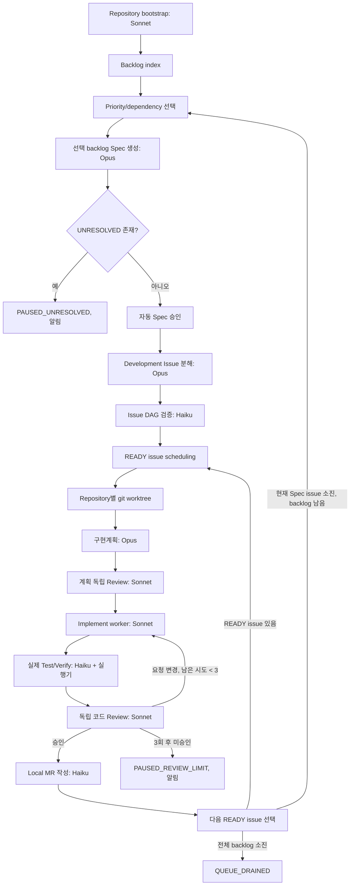

# Claude 기반 개발 하네스 생성 계획

## 1. 목적과 범위

`requirements/request-*.md`를 backlog로 읽어 승인 가능한 Spec, repository 단위 Development Issue, issue DAG, 격리된 구현·검증 worktree와 local Git MR 산출물까지 자동 생성·실행하는 오케스트레이터를 만든다.

하네스는 백로그 선택, Spec 생성·승인, 이슈 분해, 구현 계획, 구현, 실제 검증, 독립 Review, local MR 생성, 다음 READY issue 선택을 상태 기반으로 연속 실행한다. 모델 세션은 단계마다 새 `claude -p` 프로세스로 생성한다. 세션 대화를 재사용하지 않고, 재개 시에는 저장된 Markdown 산출물과 상태만 입력으로 사용한다.

하네스는 외부 Git hosting의 PR/MR을 만들지 않는다. Remote가 없는 현재 저장소에서는 branch, commit, MR 설명 Markdown으로 local MR을 표현한다.

구현 위치는 `scripts/harness`(Node ESM)이며 `pnpm harness <validate [--fix]|status|run|resume>`로 실행한다. 단계별 모델은 `lib/config.mjs`, 상태 기계는 `lib/pipeline.mjs`, 단계 프롬프트는 `lib/prompts.mjs`에 있다. 현재 구현과 이 계획의 차이는 14절에 정리한다.

## 2. Backlog 입력과 wiki context 제한

### Backlog 기준

- backlog item은 `requirements/request-*.md` 파일 하나다.
- 파일 경로에서 결정론적으로 `backlog_id`를 만든다. 예: `request-apps-local-account-contract.md` → `BL-apps-local-account-contract`.
- **backlog item 1개당 Spec 정확히 1개**를 생성한다. 한 Spec은 이후 여러 Development Issue로 분해될 수 있다.
- 입력 파서는 `Primary repository`, `Request type`, `Status`, `근거`, `UNRESOLVED`, `구현 의존성` heading을 추출하고 source file hash를 기록한다.
- `requirements/deferred/`의 요청은 backlog에 넣지 않는다. 외부 결정이 필요한 요청(현재 DAOU Office 실제 동기화)을 보류해 run이 초반에 멈추지 않게 하며, 요구사항 인용 여부 확인에만 사용한다.
- backlog triage는 우선순위를 정하는 데 필요한 질문(알 수 없거나 모순된 선행 관계)만 `UNRESOLVED`로 올리고, 범위·근거에 대한 관찰은 `notes`로 Spec 생성에 넘긴다. Spec 생성이 이를 요청과 발췌로 결정하고, 근거로 답할 수 없는 것만 `UNRESOLVED`로 남긴다.
- 요청 파일이나 그 요청의 wiki 발췌가 바뀌면(예: 사람이 `UNRESOLVED` 질문의 답을 wiki에 기록) 아직 issue로 분해되지 않은 Spec을 버리고 새 근거로 다시 생성한다. 그래서 답을 wiki에 적은 뒤 `resume`하면 된다.
- `pnpm harness validate`는 run 전에 요청 문서를 결정론적으로 검사한다: 파일명 `request-<primary repo>-<title>.md`, 인용 heading·행 범위 일치(heading 행부터 ID 행까지), 의존 방향(apps → admin/web → e2e), 모든 요구사항 ID 인용, 여러 repository에 걸친 기능의 apps·e2e 요청 존재. 결과와 요청별 근거 추적은 `.harness/preflight/`에 남긴다. `wiki/requirements.md` 행이 바뀌면 `validate --fix`가 인용을 다시 맞춘다.
- 현재 요청 파일에는 명시 priority가 없으므로 backlog index의 독립 Sonnet 세션이 item마다 P0~P3과 근거를 먼저 제안한다. Spec 생성 Opus는 이 값을 입력으로 사용하며 임의로 재정렬하지 않는다. 기존 `구현 의존성`은 선행 관계로 가져오고, 새 관계는 Spec에서 근거와 함께 제안한다.
- priority 의미는 P0=차단/보안, P1=핵심 사용자 경로, P2=지원 경로, P3=후속 개선으로 고정한다. 동률은 dependency depth, backlog ID 사전순으로 정렬한다.

### wiki 부분 발췌 규칙

- `wiki/*.md`는 먼저 heading, requirement ID, line number만 색인한다.
- backlog file이 근거로 참조한 ID의 해당 heading section만 발췌한다. 인접 section, 전체 파일, 전체 요약을 모델 context에 넣지 않는다.
- `architecture.md`, `api-spec.md`, `erd.md`도 같은 방식으로 heading index 후 현재 issue에 직접 관련된 section만 발췌한다.
- 발췌문은 `inputs/wiki-excerpts.md`와 `inputs/manifest.md`에 원본 경로·heading·line range·SHA-256으로 기록한다.
- section 범위 계산은 다음 heading 직전까지로 결정론적으로 제한하고, `wiki/requirements.md` 전체 파일 read를 금지하는 테스트를 둔다.
- `rg`가 없을 때는 동등한 line-number-aware PowerShell/Python extractor를 사용하되 전체 본문 dump fallback은 허용하지 않는다.
- 모든 Claude 세션은 `Read/Grep/Glob(wiki/**)`가 금지된다. wiki 내용은 controller가 만든 발췌로만 전달한다.

요구사항 접두어별로 전달하는 발췌 section은 `lib/wiki-context.mjs`가 고정한다.

| 요청이 인용한 ID | 발췌 section |
|---|---|
| 모든 요청 | `requirements.md`의 인용 행 범위, `api-spec.md` 「공통 규칙」·「공통 데이터 형식」 |
| `ACC-*` | `architecture.md` 「로컬 계정 및 권한 처리」, `api-spec.md` 「로컬 stub 인증 API」·「계정 및 역할 API」, `erd.md` `account`·`app_role`·`account_role`·`account_sync_run`·`admin_session` |
| `CMS-*` | `architecture.md` 「API 및 데이터 흐름」, `api-spec.md` 「관리자 콘텐츠 API」, `erd.md` `content_page`·`content_revision` |
| `WEB-*` | `architecture.md` 「애플리케이션 책임」, `api-spec.md` 「공개 API」·「관리자 메뉴 API」, `erd.md` `content_page`·`navigation_item` |

## 3. 전체 파이프라인



각 stage는 새 `claude -p` 세션으로 처리한다. 우선순위 비교, 상태 변경, DAG cycle 검사, Git 명령 실행, 테스트 명령 실행, 승인 조건 판정은 하네스 오케스트레이터가 결정론적으로 확인한다. 모델의 자연어 응답만으로 완료 상태를 바꾸지 않는다.

## 4. Stage·모델·산출물

모든 stage directory에는 입력 `input.md`와 결과 `output.md`를 canonical Markdown으로 둔다. 표에 기재된 stage별 이름(예: `spec.md`, `issue-dag.md`)은 `output.md`와 동일 hash의 사람이 찾기 쉬운 named artifact다. 모든 stage는 Claude stdout/stderr 또는 controller 실행 로그를 남기며 비모델 controller stage도 같은 input/output pair를 만든다.

| Stage | 모델 | 입력 Markdown | 출력 Markdown 및 gate |
|---|---|---|---|
| Repository bootstrap | Sonnet | workspace inventory, `.gitignore`, 기존 Git 상태 | `baseline-manifest.md`; controller는 manifest 경로만 stage/commit하고 불명확 파일은 `UNRESOLVED` 처리 |
| Backlog index/triage | Sonnet | backlog request 1건, request dependency link, wiki heading/ID index | `backlog-index.md`; ID·priority 제안·dependencies·source hash. 요청 파일 전체를 읽더라도 wiki 전체는 입력하지 않음 |
| Backlog 선택 | Sonnet | backlog index ledger, 처리 상태, backlog dependency DAG | `selection.md`; 최상위 eligible item과 선택 근거. Controller가 READY/priority를 재검증 |
| Spec 생성 | Opus | backlog request 1건, 관련 wiki 발췌 | `spec.md`; 목표, acceptance criteria, priority, dependencies, 영향 repo, 위험, `UNRESOLVED` |
| Spec 승인 | Sonnet | `spec.md`, 관련 발췌, 자동 승인 규칙 | `approval-review.md`; unresolved/risk 검사. unresolved가 없고 schema 검증 통과 시 controller가 `AUTO_APPROVED` 기록. `REQUEST_CHANGES`면 Opus가 Spec을 고쳐 다시 검토하며, 3회 안에 승인되지 않으면 `PAUSED_UNRESOLVED` |
| Issue 생성 | Opus | 승인 Spec 1건, repo 책임, 요청 문서 선후관계 | `issues.md`; repo별 변경 1개인 issue 목록, priority, dependencies, AC, 허용 path |
| Issue DAG | Haiku | `issues.md`, upstream issue links | `issue-dag.md`; 정점, edge, cycle 검사 결과, READY 집합 |
| READY 선택/worktree | Sonnet | DAG, repo lane별 READY 목록, Git base SHA | `worktree-plan.md`; 선정 issue와 branch/worktree 정보. Git 생성은 controller 수행 |
| 구현계획 | Opus | issue, 관련 wiki section, 코드 base SHA | `implementation-plan.md`; 작은 worker slices, path allowlist, 테스트, wiki 변경 계획, 순서 |
| 계획 Review | Sonnet | 승인 Spec, issue, 계획, wiki 발췌 | `plan-review.md`; 누락 AC·파일 폭·권한·문서 영향 및 승인 상태. 변경 요청이면 계획을 다시 작성하며, 3회 안에 승인되지 않으면 `PAUSED_UNRESOLVED`. 이 반복은 구현 iteration 수에 포함하지 않음 |
| Implement | Sonnet | 승인 plan slice와 issue, 필요한 코드/wikis excerpt | `implementation.md`; 변경 요약, 실제 변경 경로, 가정 및 자기검증 |
| 실제 Test/Verify | Haiku | issue AC, plan test matrix, 변경 요약 | `test-plan.md` 및 `verification.md`; controller가 실제 명령 실행 후 exit code·결과를 기록 |
| 독립 Review | Sonnet | Spec, issue, 승인 plan, diff, 실제 test artifact, wiki 발췌 | `code-review.md`; finding, severity, 파일 위치, 승인 또는 변경 요청 |
| Local MR 생성 | Haiku | 승인 review, 검증 결과, diff/stat, issue | `local-mr.md`; 제목·요약·검증·source/target branch. Git branch/commit/ref는 controller가 확인 |
| 다음 READY 선택 | Controller | 최신 state, issue DAG, backlog index, 완료 MR artifact | `next-selection.md`; 완료 wave와 남은 issue. 다음 wave 선택은 READY 선택 stage가, 다음 backlog 선택은 Backlog 선택 stage가 이어서 수행 |

Model alias는 설정에서 명시적으로 `opus`, `sonnet`, `haiku`로 관리한다. Spec·Issue·구현계획 생성만 Opus, DAG·Test 계획·local MR 본문은 Haiku, 나머지 분석·Review·선택 stage는 Sonnet을 사용한다. stage별 `claude -p` 실행에는 모델, prompt hash, session ID, 종료 코드가 남는다.

## 5. Priority, Issue DAG, 병렬 스케줄링

- Sonnet backlog triage가 backlog request별 priority와 rationale을 제안한다. Opus Spec 생성은 이 priority를 그대로 사용하며, 참조 근거가 부족해 분류할 수 없으면 `UNRESOLVED`로 기록한다.
- Issue는 각각 하나의 `primary_repository`만 변경한다: `apps`, `web`, `admin`, `e2e` 중 하나.
- DAG 검사는 Haiku가 제안한 edge를 controller가 순환·존재하지 않는 ID·다중 repo 변경 기준으로 검증한다. cycle이 있으면 issue 생성 결과를 Opus에 자동 수정 요청하고 재검증한다.
- `READY`는 모든 predecessor issue가 검증·독립 Review 승인을 완료하고 `MR_READY`가 된 issue다.
- 동시 실행은 **repo lane별**로 관리한다. 매 scheduling wave에서 각 repo의 READY issue 중 priority가 가장 높은 것 최대 1개를 선택해 apps/web/admin/e2e worker를 동시에 실행한다. 같은 repo issue는 동시 write하지 않는다. DAG predecessor가 READY가 아니면 소비자 issue는 대기한다.
- 단일 issue 계획은 package, layer, 화면 단위의 worker slice로 분리한다. slice마다 명시적 파일 allowlist와 완료조건을 갖고, 기본 source 변경 폭은 5개 파일 이내로 제한한다. 초과하면 slice를 더 나눈다.
- 한 issue의 slice는 issue worktree 하나에서 계획 순서(`depends_on`)대로 **순차 실행**한다. slice마다 새 Implement 세션을 쓰고, 세션이 끝날 때마다 controller가 변경 경로가 slice·issue allowlist 안인지 확인한다. slice 병렬화는 같은 repo 안의 통합 충돌 비용이 커서 채택하지 않는다. 병렬성은 repo lane(apps/web/admin/e2e) 단위로 확보한다.
- 구현계획에는 코드와 함께 변경 가능성이 있는 `requirements`, `architecture`, `api-spec`, `erd` section을 모두 식별한다. 실제 변경이 불필요하면 이유를 적고 파일을 수정하지 않는다.
- wiki 변경은 코드 slice와 분리된 **wiki slice**로 계획한다. 세션은 wiki 파일을 읽을 수 없으므로, wiki slice 세션은 발췌된 section과 계획만 받아 `{path, heading, markdown}` 형식의 section 교체안을 반환하고, controller가 heading index로 해당 section 범위만 결정론적으로 교체한다. 교체는 발췌로 전체가 전달된 section만, heading 행을 바꾸지 않는 경우에만 허용한다. `wiki/requirements.md`는 발췌가 절 일부이므로 요구사항 ID 한 줄 단위 교체만 허용하고 새 ID 추가는 허용하지 않는다. 한 줄 교체라 다른 행 번호와 요청 문서 인용은 바뀌지 않는다. 교체안이 규칙을 어기면 거부 사유를 붙여 최대 3회 다시 요청하고, 그래도 거부되면 `PAUSED_UNRESOLVED`로 멈춘다(`lib/wiki-patch.mjs`).

## 6. 구현·검증·독립 Review 반복 규칙

- 한 iteration은 `Implement → 실제 Test/Verify → 독립 Review`다. Plan 생성 및 plan review는 iteration count에 포함하지 않는다.
- 리뷰의 차단 기준은 severity로 정한다. 계획 리뷰는 P0/P1(완료 조건 누락, repository 경계 위반, slice 겹침·과대, 잘못된 테스트 명령)만 계획을 되돌리고, P2/P3는 구현 worker에 참고로 전달한다. 코드 리뷰는 P0~P2만 iteration을 되돌리고 P3는 MR 설명에 남긴다. 계획 리뷰와 코드 리뷰는 issue worktree를 읽기 전용으로 볼 수 있다(`wiki/` 제외).
- 리뷰의 `UNRESOLVED`는 구현 루프 안에서 누구도 정할 수 없는 제품·보안·소유권 결정에만 쓴다. 문서 표현이나 검증하지 못한 사항은 finding으로 돌려보낸다.
- 독립 Review는 Implement와 별도 `claude -p` 프로세스/세션에서 수행한다. Implement 세션 transcript나 미제출 메모는 전달하지 않는다.
- Review 입력은 승인 Spec/Issue/plan, 실제 diff, 실제 test logs, 필요한 wiki 발췌뿐이다. Reviewer는 같은 worktree에 파일을 수정하지 않는다.
- Test 실패 또는 Review의 `REQUEST_CHANGES`는 다음 iteration의 Implement 입력이 된다. 시도 수는 issue 단위로 1, 2, 3까지 기록한다.
- 3번째 iteration Review가 승인되지 않으면 4번째 구현을 실행하지 않고 `PAUSED_REVIEW_LIMIT`로 상태를 저장해 알린다.
- Test 결과는 모델이 생성한 주장으로 PASS 처리하지 않는다. controller가 allowlist 명령을 실행하고 exit code, stdout/stderr log, artifact hash를 기록해야 PASS다.
- `UNRESOLVED`가 Spec, Issue, plan, Test, Review 중 어디에서든 발견되면 `PAUSED_UNRESOLVED`로 전환하고 담당자에게 해당 문서와 질문만 알린다. 해결 후 같은 state에서 재개한다.

## 7. git worktree와 Local MR

- root 저장소에서 issue마다 `harness/<issue-id>` branch 및 `.worktrees/<issue-id>` worktree를 사용한다. branch 생성 시 state에 저장된 base SHA를 사용한다.
- 하네스는 `main`/기준 branch를 직접 수정하지 않는다. 모델 worker는 할당된 worktree의 허용 path 외 파일을 수정할 수 없다.
- Review 승인 후 controller가 allowlist 경로만 stage하고 issue 단위 commit을 생성한다. commit message에는 backlog ID와 issue ID를 넣는다.
- Local MR은 `.harness/runs/<run-id>/merge-requests/<issue-id>.md` 및 로컬 source branch로 표현한다. remote push, GitHub/GitLab API 호출은 하지 않는다.
- DAG dependency는 upstream의 `MR_READY`와 해당 source branch를 기록한다. downstream worktree base는 필요한 predecessor branch를 통합한 local integration SHA다.
- backlog item이 완료되면 그 issue commit을 run 누적 integration branch(`harness/integration/<backlog-id>--accumulated-*`)로 통합하고 run base를 그 tip으로 옮긴다. 다음 backlog item의 issue는 앞선 backlog의 코드 위에서 시작한다. run base는 run 시작 시 정하고 `resume` 때 다시 정하지 않는다.
- 새 `run`은 이전 run에서 완료된 backlog item과 그 issue를 이어받아 다시 처리하지 않는다. 이어받은 issue commit이 현재 branch에 병합되어 있지 않으면 병합할 branch 목록과 함께 멈춘다. `main` 병합은 사람이 한다.
- `main`에 commit이 있으면 bootstrap은 현재 `HEAD`를 base로 사용한다(현재 저장소는 초기 commit `chore: bootstrap homepage CMS workspace`가 있다). commit이 없는 저장소에서는 최초 run의 bootstrap stage가 workspace inventory로 명시적 baseline path manifest를 만들고, manifest에 든 경로만 controller가 stage해 초기 commit을 자동 생성한다. `git add .`는 금지한다. manifest로 목적을 판별할 수 없는 untracked 파일이 있으면 이를 `UNRESOLVED`로 저장하고 멈춘다. baseline commit 완료 후에만 issue worktree를 만든다.
- remote MR 게시가 필요한 경우 별도의 adapter와 credential 설계를 추가하고, 이 계획의 local MR 기능과 분리한다.

## 8. State, 재개, 중복 방지

### 영속 파일

- `.harness/state/run.json`: 전체 run 상태와 현재 cursor
- `.harness/state/issues/<issue-id>.json`: issue별 상태, attempts, branch/worktree, artifact refs
- `.harness/state/lock`: 단일 orchestrator lease와 heartbeat
- state 갱신은 temp file 작성 후 atomic rename을 사용한다. 각 stage 시작/완료, Git commit, test, Review 및 MR artifact 저장 직후 checkpoint한다.

### 최소 state fields

`schema_version`, `run_id`, `base_sha`, `phase`, `active_backlog_id`, `active_issue_ids`, `backlog_cursor`, `spec_status`, `dag_sha`, `repo_lanes`, issue별 `status`, `attempt`, `worktree`, `branch`, `last_completed_stage`, `artifact_paths`, `log_paths`, `input_hashes`, `claude_session_ids`, `updated_at`.

### 재개 동작

- `harness run`: 새 run 및 backlog snapshot 생성
- `harness resume`: state lock 획득, 마지막 미완료 stage의 input hash 확인 후 누락 단계만 실행
- `harness status`: phase, repo lane, READY/BLOCKED issue, unresolved 및 최신 log 위치 출력
- 동일한 `(run_id, backlog_id, issue_id, stage, attempt)` artifact가 있으면 hash와 schema를 검증해 중복 생성 대신 재사용한다.
- 프로세스 강제 종료 후 worktree branch와 마지막 checkpoint가 일치하면 이어서 실행하고, 파일 변경은 있으나 stage 완료 기록이 없으면 해당 stage를 재실행한다.

## 9. Artifact와 log 디렉터리

```text
.harness/
  state/run.json
  state/issues/<issue-id>.json
  alerts/<run-id>-<reason>.md
  runs/<run-id>/
    inputs/wiki-excerpts.md
    inputs/manifest.md
    bootstrap/{input,output}.md
    bootstrap/baseline-manifest.md
    backlog/input.md
    backlog/output.md
    backlog/backlog-index.md
    specs/<backlog-id>/input.md
    specs/<backlog-id>/output.md
    specs/<backlog-id>/spec.md
    approvals/<backlog-id>/input.md
    approvals/<backlog-id>/output.md
    approvals/<backlog-id>/approval-review.md
    issues/<backlog-id>/input.md
    issues/<backlog-id>/output.md
    issues/<backlog-id>/issues.md
    dags/<backlog-id>/input.md
    dags/<backlog-id>/output.md
    dags/<backlog-id>/issue-dag.md
    selection/<cycle-id>/{input,output}.md
    selection/<cycle-id>/worktree-plan.md
    selection/<cycle-id>/next-selection.md
    issues/<issue-id>/plans/attempt-01/input.md
    issues/<issue-id>/plans/attempt-01/output.md
    issues/<issue-id>/plans/attempt-01/implementation-plan.md
    issues/<issue-id>/plans/attempt-01/plan-review.md
    issues/<issue-id>/iterations/01/{implementation,test,review}/{input,output}.md
    issues/<issue-id>/iterations/01/implementation/implementation.md
    issues/<issue-id>/iterations/01/test/test-plan.md
    issues/<issue-id>/iterations/01/test/verification.md
    issues/<issue-id>/iterations/01/review/code-review.md
    issues/<issue-id>/iterations/01/verification.md
    issues/<issue-id>/merge-request/{input,output}.md
    issues/<issue-id>/merge-request/local-mr.md
    issues/<issue-id>/iterations/<n>/implementation/<slice-id>/{input,output}.md
    issues/<issue-id>/iterations/<n>/test/commands/<test-id>.log
    merge-requests/<issue-id>.md
    <stage>/session.json
    logs/<stage>/<session-id>.jsonl
    logs/<stage>/<session-id>.stderr.log
    logs/controller.jsonl
```

각 모델 stage directory의 `session.json`에는 model, session ID, input SHA-256, exit code가 남는다. 같은 stage를 같은 입력으로 다시 실행하면 저장된 `output.md`를 재사용하므로, `resume`은 완료된 모델 호출을 반복하지 않는다.

각 모델 호출은 markdown input/output 이외에 raw JSONL/stdout/stderr를 별도 저장한다. Controller의 Git·테스트 실행도 stage별 `.log`와 exit code를 저장한다. 각 output에는 사용 model, stage, timestamp, source artifact hash, reviewer result를 front matter 또는 표준 header로 기록한다.

`.harness/` runtime state, artifacts, logs는 로컬에서 재개 가능하도록 보존하되 Git source commit에는 포함하지 않는다. 장기 보존/export는 별도 backup 기능으로 처리한다.

중단 알림은 `.harness/alerts/<run-id>-<reason>.md`에 질문, 관련 Spec/Issue, 관련 input excerpt와 재개 방법을 기록한다. 알림은 전체 wiki를 복제하지 않는다.

## 10. 자동 승인과 중단 조건

### 자동 Spec 승인

Spec은 다음을 모두 만족하면 승인 요청 없이 `AUTO_APPROVED`로 전환한다.

- 명시된 모든 source requirement ID가 실제 부분 발췌와 일치한다.
- 목표, acceptance criteria, primary repository 후보, priority rationale, dependency가 구조 검증을 통과한다.
- `UNRESOLVED` 목록이 비어 있다.
- 관련 wiki 발췌의 path/heading/range/hash manifest가 저장되어 있다.

### 사용자 알림이 필요한 정지

1. `UNRESOLVED` 항목이 하나 이상 발생하면 현재 작업을 체크포인트하고 질문·근거·영향받는 issue를 알린다.
2. issue의 세 번째 Implement/Test/Review iteration까지 독립 Review 승인을 받지 못하면 state와 세 번의 review findings를 저장하고 알린다.

Claude 인증/네트워크, Git lock, 테스트 인프라 오류는 사용자 결정 상태로 바꾸지 않는다. backoff 후 자동 재시도하고, 재시도 중에도 checkpoint/log를 보존한다. 수동 중지 후에는 `resume`으로 재개한다.

모델 출력이 요청한 JSON schema를 따르지 않는 오류는 인프라 오류와 구분한다. 같은 stage에서 3회 연속 발생하면 무한 재시도하지 않고 `PAUSED_UNRESOLVED`로 멈추며, 마지막 출력 경로를 알림에 남긴다.

## 11. 보안 및 변경 경계

- 각 Claude 세션에는 최소 context와 해당 worktree만 제공한다. API key, token, 전체 process environment를 prompt나 log에 넣지 않는다.
- repo별 허용 경로를 issue에 선언하고, stage 후 변경 경로가 allowlist 밖이면 자동 Review로 넘기지 않고 격리·수정한다.
- `requirements` backlog 원문은 자동 편집하지 않는다. 승인 Spec과 구현계획에 명시된 wiki 문서 변경만 검토 대상이다.
- Git 기본 branch, 사용자 설정 파일, 다른 repo lane worktree는 worker가 수정하지 않는다.
- model 출력은 untrusted data로 취급한다. shell command는 issue plan에 등록된 allowlist와 controller policy를 통해서만 실행한다.

## 12. 구현 순서

1. **Harness foundation**: request parser, heading-only wiki index/section extractor, artifact schema, `run.json`, stage logger, `claude -p` wrapper.
2. **Planning automation**: backlog priority, Spec generation/auto-approval, Issue split, Haiku DAG validation, unresolved pause.
3. **Git scheduler**: base SHA validation, repo-lane READY scheduler, worktree/branch lifecycle, atomic state/restart recovery.
4. **Worker loop**: Opus implementation plan, independent Sonnet plan review, bounded slice workers, Haiku actual test runner, independent Sonnet code review, 최대 3 iterations.
5. **Local MR/queue**: Haiku MR body, controller commit and local MR Markdown, dependency branch integration, next READY scheduling.
6. **Recovery/acceptance**: 강제 종료·중복 호출·cycle·unresolved·3회 거부·wiki 부분 발췌 준수 시나리오를 E2E로 검증한다.

## 13. 하네스 완료 기준

- backlog request 하나가 정확히 Spec 하나를 만들고 source ID/heading/range가 추적된다.
- 지정한 model mapping과 매 단계 독립 `claude -p` session이 log에 기록된다.
- `UNRESOLVED` 없는 Spec은 자동 승인되고, 존재 시 state checkpoint 후 멈춘다.
- 네 repository issue lane이 DAG에 따라 병렬 동작하고 각 issue는 별도 worktree에 격리된다.
- 구현계획이 코드와 wiki 수정 계획, package/layer/screen 단위 bounded slices를 포함한다.
- 실제 테스트는 controller 실행 결과로만 PASS가 되며, 독립 Review가 구현 session과 분리된다.
- 구현/Test/Review iteration은 최대 세 번이고 초과 실행이 없다.
- local MR 산출물 이후 다음 READY issue를 자동 선택한다.
- 강제 종료 뒤 state만으로 마지막 완료 stage 다음부터 재개한다.
- 관련 wiki 문서 전체가 어떤 Claude context에도 포함되지 않았음을 input manifest/log로 입증한다.

## 14. 대시보드

`admin`의 `/harness`(로컬 전용)에서 진행 상태를 보고 사람 결정을 입력한다.

- 요구사항 탭: 전체(등록·승인)와 현재 상태(사람 개입 필요·진행 중) 수, 우선순위순 진행 가능 목록, 완료 목록. 선택하면 단계 진행, 사람 결정, Spec, 이슈, 단계별 처리 로그를 보여준다.
- 이슈 탭: 전체(등록·MR 생성)와 현재 상태 수, 우선순위순 진행 가능 목록과 고정, 완료 목록, 선택한 이슈의 단계 진행과 처리 로그.
- 처리 로그는 단계별 아코디언이며 입력·출력·로그를 탭으로 본다. Markdown은 HTML로 렌더링하고, 모델 응답의 `markdown` 필드는 문서로, 나머지 필드는 JSON으로 보여준다.
- 목록과 상세는 몇 초마다 폴링하지만 내용이 바뀐 부분만 다시 그려, 스크롤 위치와 열린 패널이 유지된다. 단계 내용은 펼칠 때만 불러온다.
- 사람 결정: Spec의 `UNRESOLVED` 질문(선택지가 있으면 선택, 직접 입력 가능)에 답하고, Spec을 수정하고, 승인한다. 승인은 열린 질문이 없을 때만 가능하고, 수정하면 이전 승인 요청은 취소된다. 자동 승인 검토가 세 번 반려하면 Spec은 `NEEDS_HUMAN_REVIEW`로 멈추고 사람이 수정하거나 승인한다.
- 고정한 이슈는 같은 repo lane에서 먼저 처리한다. 다른 lane의 병렬 실행은 유지된다.
- 대시보드는 run state를 직접 쓰지 않는다. 실행 중인 오케스트레이터가 state를 메모리에 두고 덮어쓰기 때문이다. 대신 `.harness/commands/`에 명령 파일을 남기고, 오케스트레이터가 시작, backlog 선택 전, issue wave 선택 전 checkpoint에서 적용한 뒤 결과와 함께 `processed/`로 옮긴다. 멈춘 run은 결정을 입력한 뒤 `pnpm harness resume`으로 재개한다.

## 15. 구현 현황과 남은 작업

`scripts/harness` 구현은 1~13절의 흐름을 갖췄다: 단계별 독립 `claude -p` 세션과 모델 매핑, wiki 부분 발췌, 자동 Spec 승인과 수정 반복, issue DAG 검증, repo lane 병렬 wave, 구현계획·계획 Review, code/wiki slice, 최대 3회 구현·검증·Review, controller 테스트 실행, local MR, 파일 state·lock·재개, 단계별 input/output·session·log 기록, 요청 문서 사전 검사.

다음 항목은 계획과 맞지 않던 부분을 고친 기록이다.

| 항목 | 이전 동작 | 현재 동작 |
|---|---|---|
| wiki 변경 적용 | Implement 세션이 `wiki/**`를 읽을 수 없어 계획된 wiki 변경을 적용하지 못했다 | wiki slice가 section 교체안을 반환하고 controller가 적용(5절). 발췌는 issue worktree 기준으로 만들어 선행 issue의 wiki 변경을 반영 |
| 병렬 lane 상태 | 각 lane이 `active_issue_ids`를 자기 issue로 덮어썼다 | wave만 `active_issue_ids`를 관리. lane 하나가 멈추거나 실패해도 나머지 lane이 checkpoint까지 진행한 뒤 멈춤 |
| schema 오류 재시도 | JSON schema 오류도 무한 backoff 재시도했다 | 3회 연속이면 `PAUSED_UNRESOLVED`(10절) |
| e2e 검증 환경 | `web`만 띄워 관리자·API가 필요한 E2E를 검증할 수 없었다 | Playwright가 API·web·admin을 모두 띄운다. 하네스는 실행마다 빈 포트와 전용 DB(`homepage_e2e_*`, 실행 후 삭제)를 할당 |
| Windows 명령 실행 | Node가 shell 없이 `pnpm.cmd`를 실행하지 못해 worktree 설치와 web·admin·e2e 검증이 모두 실패했다 | `.cmd`/`.bat`은 `cmd.exe`로 인수를 인용해 실행 |
| Review diff 기준 | run base 기준 diff라 선행 issue 변경까지 Review 대상에 섞였다 | issue 자신의 base 기준 diff |

남은 작업:

| 항목 | 현재 동작 | 필요한 변경 |
|---|---|---|
| wave 대기 | 한 wave의 모든 lane이 끝나야 다음 wave를 선택해, 빠른 lane이 느린 lane을 기다린다 | lane별 완료 즉시 다음 READY issue를 채우는 스케줄러(선택 사항) |
| 전체 run 검증 | 단계 단위 테스트와 e2e 실행 경로는 검증했지만 실제 `claude`로 backlog 하나를 끝까지 돌린 기록은 없다 | 작은 backlog 하나로 `pnpm harness run` 시험 실행 후 산출물·로그 점검 |
