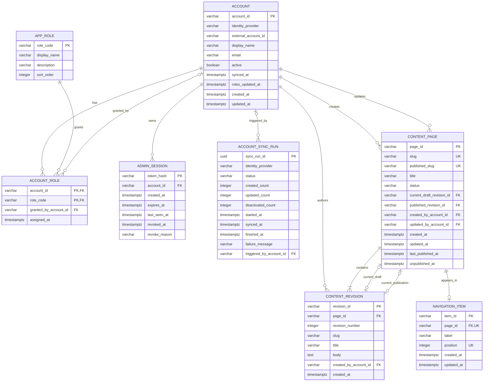

# 관리 데이터 ERD

> 기준: [API 명세](api-spec.md), [요구사항](requirements.md), [로컬 아키텍처](architecture.md)\
> DB: PostgreSQL 18. 모든 시간 컬럼은 `timestamptz`로 저장하고 API 응답은 UTC ISO-8601로 직렬화한다.\
> 스키마는 `apps/api/src/main/resources/db/migration`의 Flyway migration으로만 만든다.

## 1. ERD

`content_page`와 `content_revision`은 서로를 참조한다. 두 revision 포인터는 같은 `page_id`의 revision만 가리키도록 `(page_id, revision_id)` 복합 외래 키로 두고, `DEFERRABLE INITIALLY DEFERRED`로 선언해 페이지와 첫 revision을 한 트랜잭션에서 저장할 수 있게 한다.

서버가 발급하는 ID는 접두어와 ULID(26자)를 붙인 문자열이다: 페이지 `pg_`, revision `rev_`, 메뉴 항목 `nav_`. 동기화 실행 ID만 `uuid`를 쓴다.

## 2. 테이블 정의

### `account`

DAOU Office 또는 로컬 stub 디렉터리에서 동기화한 계정의 현재 상태를 저장한다. 관리자 로그인 후보는 이 테이블에 있는 계정뿐이다.

| 컬럼 | PostgreSQL 형식 | 제약 | API 필드 및 의미 |
|---|---|---|---|
| `account_id` | `varchar(120)` | PK | `accountId`, `updatedBy`, `triggeredBy`에 쓰이는 계정 ID |
| `identity_provider` | `varchar(32)` | 필수, CHECK `STUB`·`DAOU_OFFICE` | 동기화 출처 |
| `external_account_id` | `varchar(160)` | 필수 | 계정 공급자에서 받은 원본 ID |
| `display_name` | `varchar(160)` | 필수 | `displayName` |
| `email` | `varchar(320)` | 필수 | `email`. 공급자 간 중복 가능 |
| `active` | `boolean` | 필수, 기본 `true` | `active`. `false`면 로그인과 API 호출 거부 |
| `synced_at` | `timestamptz` | 필수 | `syncedAt`. 마지막으로 디렉터리에서 확인된 시각 |
| `roles_updated_at` | `timestamptz` | 필수 | `rolesUpdatedAt`. 역할이 실제로 바뀐 마지막 시각 |
| `created_at` | `timestamptz` | 필수 | 최초 동기화 시각 |
| `updated_at` | `timestamptz` | 필수 | 계정 정보 최종 변경 시각 |

- `UNIQUE (identity_provider, external_account_id)`로 반복 동기화 시 중복 생성을 막는다. `account_id`는 최초 upsert 때 정하고 바꾸지 않는다.
- 디렉터리에서 비활성화되었거나 사라진 계정은 삭제하지 않고 `active=false`로 바꾼다. 콘텐츠 작성 이력의 외래 키 때문에 물리 삭제하지 않는다.

### `app_role`

관리자 역할 코드와 표시 정보를 저장하는 참조 테이블이다.

| 컬럼 | PostgreSQL 형식 | 제약 | API 필드 및 의미 |
|---|---|---|---|
| `role_code` | `varchar(32)` | PK, CHECK `ROLE_MANAGER`·`CONTENT_EDITOR`·`PUBLISHER` | `roles[]`, path `roleCode` |
| `display_name` | `varchar(80)` | 필수 | 관리자 화면 표시명 (권한 관리자, 콘텐츠 편집자, 게시 담당자) |
| `description` | `varchar(300)` | 필수 | 역할 설명 |
| `sort_order` | `integer` | 필수, UNIQUE | `roles[]` 응답 정렬 순서 |

세 역할은 migration seed로 넣으며, API의 허용 값과 일치해야 한다.

### `account_role`

계정에 현재 부여된 역할이다. 부여는 행 추가, 회수는 행 삭제로 처리한다.

| 컬럼 | PostgreSQL 형식 | 제약 | API 필드 및 의미 |
|---|---|---|---|
| `account_id` | `varchar(120)` | PK 일부, FK → `account` (`ON DELETE CASCADE`) | 대상 계정 |
| `role_code` | `varchar(32)` | PK 일부, FK → `app_role` | 부여된 역할 |
| `granted_by_account_id` | `varchar(120)` | nullable, FK → `account` | 부여한 권한 관리자. 로컬 fixture가 부여하면 `NULL` |
| `assigned_at` | `timestamptz` | 필수 | 부여 시각 |

- 이미 있는 역할 부여와 없는 역할 회수는 행을 바꾸지 않고 `roles_updated_at`도 갱신하지 않는다.
- `ROLE_MANAGER` 회수 전에는 해당 역할 행을 `FOR UPDATE`로 잠그고, 활성 계정의 `ROLE_MANAGER`가 하나만 남으면 `409 LAST_ROLE_MANAGER`로 거부한다.
- 계정의 마지막 역할이 회수되면 같은 트랜잭션에서 그 계정의 유효 세션을 `revoke_reason='ROLES_REVOKED'`로 폐기한다.

### `account_sync_run`

계정 동기화 1회의 실행 결과다. `SyncRun` 응답과 마지막 동기화 조회는 이 테이블에서 만든다.

| 컬럼 | PostgreSQL 형식 | 제약 | API 필드 및 의미 |
|---|---|---|---|
| `sync_run_id` | `uuid` | PK | `syncRunId` |
| `identity_provider` | `varchar(32)` | 필수, CHECK `STUB`·`DAOU_OFFICE` | `identityProvider` |
| `status` | `varchar(16)` | 필수, CHECK `RUNNING`·`SUCCEEDED`·`FAILED` | `status` |
| `created_count` | `integer` | 필수, 기본 0, CHECK ≥ 0 | `createdCount` |
| `updated_count` | `integer` | 필수, 기본 0, CHECK ≥ 0 | `updatedCount` |
| `deactivated_count` | `integer` | 필수, 기본 0, CHECK ≥ 0 | `deactivatedCount` |
| `started_at` | `timestamptz` | 필수 | `startedAt` |
| `synced_at` | `timestamptz` | nullable | `syncedAt`. `SUCCEEDED`일 때만 값이 있음 |
| `finished_at` | `timestamptz` | nullable | 성공·실패로 끝난 시각. 응답에는 노출하지 않음 |
| `failure_message` | `varchar(1000)` | nullable | `FAILED` 원인. 서버 로그 확인용이며 응답에는 노출하지 않음 |
| `triggered_by_account_id` | `varchar(120)` | nullable, FK → `account` | `triggeredBy`. 자동 실행이면 `NULL` |

- `CHECK ((status = 'SUCCEEDED') = (synced_at IS NOT NULL))`, `CHECK ((status = 'RUNNING') = (finished_at IS NULL))`.
- `status='RUNNING'`인 행에 부분 UNIQUE 인덱스(`ON account_sync_run ((true)) WHERE status = 'RUNNING'`)를 두어 동시에 하나만 실행되게 한다. 이 제약 위반은 `409 SYNC_IN_PROGRESS`로 변환한다.
- 동기화로 비활성이 된 계정의 유효 세션은 같은 트랜잭션에서 `revoke_reason='ACCOUNT_DEACTIVATED'`로 폐기한다.

### `admin_session`

`local_session` 쿠키의 서버 측 세션이다. 쿠키 원문은 저장하지 않고 해시만 저장한다.

| 컬럼 | PostgreSQL 형식 | 제약 | API 필드 및 의미 |
|---|---|---|---|
| `token_hash` | `varchar(128)` | PK | 쿠키 토큰의 SHA-256 해시 |
| `account_id` | `varchar(120)` | 필수, FK → `account` | 로그인 계정 |
| `created_at` | `timestamptz` | 필수 | 로그인 시각 |
| `expires_at` | `timestamptz` | 필수, CHECK `expires_at > created_at` | `expiresAt`. 로그인 후 8시간 |
| `last_seen_at` | `timestamptz` | nullable | 마지막으로 인증된 요청 시각 |
| `revoked_at` | `timestamptz` | nullable | 폐기 시각 |
| `revoke_reason` | `varchar(32)` | nullable, CHECK `LOGOUT`·`ROLES_REVOKED`·`ACCOUNT_DEACTIVATED` | 폐기 사유 |

- `CHECK ((revoked_at IS NULL) = (revoke_reason IS NULL))`.
- 유효한 세션은 `revoked_at IS NULL`, `expires_at > now()`, 계정 `active=true`, 계정 역할 1개 이상을 모두 만족해야 한다.
- 폐기된 세션의 응답 상태는 `revoke_reason`으로 정한다: `LOGOUT`은 `401 UNAUTHORIZED`, `ROLES_REVOKED`·`ACCOUNT_DEACTIVATED`는 `403 FORBIDDEN`.

### `content_page`

페이지의 고정 ID, 작업 slug, 공개 slug, 목록용 제목, 공개 상태, revision 포인터를 저장한다.

| 컬럼 | PostgreSQL 형식 | 제약 | API 필드 및 의미 |
|---|---|---|---|
| `page_id` | `varchar(40)` | PK | `pageId` |
| `slug` | `varchar(160)` | 필수, UNIQUE, CHECK slug 형식 | `slug`. 현재 작업 slug. 초안을 저장할 때 갱신 |
| `published_slug` | `varchar(160)` | nullable, UNIQUE, CHECK slug 형식 | `publishedSlug`, 공개 API·메뉴의 `slug`. 게시할 때 갱신하고 비게시 후에도 예약 유지 |
| `title` | `varchar(160)` | 필수 | `PageSummary.title`. 초안이 있으면 초안 제목, 없으면 공개 revision 제목. 초안 저장·게시 때 갱신 |
| `status` | `varchar(16)` | 필수, CHECK `DRAFT`·`PUBLISHED`·`UNPUBLISHED` | `status` |
| `current_draft_revision_id` | `varchar(40)` | nullable, 복합 FK → `content_revision` | `draft`, `hasDraft` |
| `published_revision_id` | `varchar(40)` | nullable, 복합 FK → `content_revision` | `published`. 비게시하면 `NULL` |
| `created_by_account_id` | `varchar(120)` | 필수, FK → `account` | 최초 작성자 |
| `updated_by_account_id` | `varchar(120)` | 필수, FK → `account` | `PageSummary.updatedBy` |
| `created_at` | `timestamptz` | 필수 | `createdAt` |
| `updated_at` | `timestamptz` | 필수 | `updatedAt`. 목록 정렬 기준 |
| `last_published_at` | `timestamptz` | nullable | `publishedAt`. 게시 이력 여부 판단에도 사용 |
| `unpublished_at` | `timestamptz` | nullable | `unpublishedAt` |

상태별 CHECK:

| `status` | `published_revision_id` | `current_draft_revision_id` | `last_published_at` |
|---|---|---|---|
| `DRAFT` | `NULL` | NOT NULL | `NULL` |
| `PUBLISHED` | NOT NULL | 값 있거나 `NULL` (수정 초안 여부) | NOT NULL |
| `UNPUBLISHED` | `NULL` | 값 있거나 `NULL` | NOT NULL |

상태 전이 (각 전이는 한 트랜잭션):

- 새 페이지: `DRAFT`로 생성하고 첫 revision을 draft 포인터에 연결한다. `slug`, `title`을 revision 값으로 설정한다.
- 초안 저장: 새 revision을 만들고 draft 포인터를 옮긴다. `slug`, `title`, `updated_*`를 갱신한다. 공개 포인터와 `published_slug`는 바꾸지 않는다.
- 게시·재게시: 요청의 `revisionId`가 draft 포인터와 같은지 행 잠금 후 확인한다. draft revision을 공개 포인터로 옮기고 draft 포인터를 `NULL`로 비운 뒤 `status='PUBLISHED'`, `published_slug`, `last_published_at`을 설정하고 `unpublished_at`을 `NULL`로 비운다.
- 비게시: 공개 포인터를 `NULL`로 만들고 `status='UNPUBLISHED'`, `unpublished_at`을 설정한다. 수정 초안과 메뉴 항목은 유지한다.
- 삭제: `last_published_at IS NULL`인 페이지만 허용한다. 페이지·revision·메뉴 행을 함께 삭제한다.

slug는 `^[a-z0-9]+(?:-[a-z0-9]+)*$`를 CHECK로 강제한다. 한 페이지의 `slug`는 다른 페이지의 `slug`·`published_slug`와 겹치면 안 되므로, 저장과 게시 전에 서비스 계층에서 두 컬럼을 함께 확인한다. 이 확인은 `pg_advisory_xact_lock(hashtext(slug))`로 같은 slug의 동시 저장을 직렬화한다. 확인을 통과한 뒤에도 UNIQUE 위반이 나면 `409 SLUG_CONFLICT`로 변환한다.

### `content_revision`

초안과 게시 본문을 변경 불가능한 revision으로 저장한다. 초안을 저장할 때마다 새 행을 만든다.

| 컬럼 | PostgreSQL 형식 | 제약 | API 필드 및 의미 |
|---|---|---|---|
| `revision_id` | `varchar(40)` | PK | `revisionId` |
| `page_id` | `varchar(40)` | 필수, FK → `content_page` (`ON DELETE CASCADE`) | 소속 페이지 |
| `revision_number` | `integer` | 필수, CHECK ≥ 1 | `revision`. 페이지 안에서 1부터 증가 |
| `slug` | `varchar(160)` | 필수, CHECK slug 형식 | `draft.slug`, `published.slug`, 미리보기 `slug` |
| `title` | `varchar(160)` | 필수, CHECK `char_length(btrim(title)) BETWEEN 1 AND 160` | `title` |
| `body` | `text` | 필수, CHECK `char_length(body) <= 200000` | `body` (Markdown 원문) |
| `created_by_account_id` | `varchar(120)` | 필수, FK → `account` | `draft.updatedBy`, 미리보기 `updatedBy` |
| `created_at` | `timestamptz` | 필수 | `draft.updatedAt`, 미리보기 `updatedAt`, 공개 API `updatedAt` |

- `UNIQUE (page_id, revision_number)`, `UNIQUE (page_id, revision_id)`(복합 FK 대상).
- `revision_number`는 페이지 행을 잠근 상태에서 `max + 1`로 정한다.
- revision은 만든 뒤 수정하지 않는다. 이전 초안과 공개 revision은 모두 보존된다.

### `navigation_item`

공개 홈페이지 메뉴의 항목과 순서다.

| 컬럼 | PostgreSQL 형식 | 제약 | API 필드 및 의미 |
|---|---|---|---|
| `item_id` | `varchar(40)` | PK | `itemId` |
| `page_id` | `varchar(40)` | 필수, UNIQUE, FK → `content_page` (`ON DELETE CASCADE`) | `pageId`. 페이지당 메뉴 항목 최대 하나 |
| `label` | `varchar(80)` | 필수, CHECK `char_length(btrim(label)) BETWEEN 1 AND 80` | `label` |
| `position` | `integer` | 필수, CHECK ≥ 0, UNIQUE `DEFERRABLE INITIALLY DEFERRED` | `position` |
| `created_at` | `timestamptz` | 필수 | 추가 시각 |
| `updated_at` | `timestamptz` | 필수 | 표시명·순서 최종 변경 시각 |

- `position`은 0부터 빈틈없이 이어진다. 추가는 `max + 1`, 삭제는 뒤 항목을 1씩 당기고, 이동은 인접 항목과 값을 맞바꾼다. 교환 중 일시적으로 값이 겹치므로 UNIQUE를 지연 검사한다.
- 메뉴 변경은 `navigation_item` 전체를 `LOCK ... IN SHARE ROW EXCLUSIVE MODE`로 잠근 뒤 처리해 순서 계산이 겹치지 않게 한다.
- 추가는 `content_page.status='PUBLISHED'`인 페이지만 허용한다. 이후 비게시되어도 행은 남고 공개 메뉴에서만 빠진다.

## 3. API 필드와 저장 위치 대응

| API | 필드 | 저장 위치 또는 계산 방식 |
|---|---|---|
| `Account` | `accountId`, `displayName`, `email`, `active`, `syncedAt` | `account` 같은 이름의 컬럼 |
| `Account` | `roles` | `account_role` ⋈ `app_role`, `sort_order` 순 |
| 역할 부여·회수 | `rolesUpdatedAt` | `account.roles_updated_at` |
| 로컬 계정 목록 | `items[]` | `account WHERE identity_provider='STUB'` |
| 로그인·세션 | `expiresAt` | `admin_session.expires_at` |
| 로그인·세션 | `local_session` 쿠키 | 원문은 브라우저만 보유. 해시는 `admin_session.token_hash` |
| `SyncRun` | `syncRunId`, `identityProvider`, `status`, `createdCount`, `updatedCount`, `deactivatedCount`, `startedAt`, `syncedAt` | `account_sync_run` 같은 이름의 컬럼 |
| `SyncRun` | `triggeredBy` | `account_sync_run.triggered_by_account_id` |
| 마지막 동기화 | - | `account_sync_run ORDER BY started_at DESC LIMIT 1` |
| `PageSummary` | `pageId`, `slug`, `title`, `status`, `updatedAt` | `content_page` |
| `PageSummary` | `hasDraft` | `current_draft_revision_id IS NOT NULL` |
| `PageSummary` | `publishedAt` | `content_page.last_published_at` |
| `PageSummary` | `updatedBy` | `content_page.updated_by_account_id` |
| `PageDetail` | `pageId`, `slug`, `publishedSlug`, `status`, `createdAt`, `updatedAt` | `content_page` |
| `DraftRevision` | `revisionId`, `revision`, `slug`, `title`, `body`, `updatedAt`, `updatedBy` | draft 포인터의 `content_revision` (`revision_number`, `created_at`, `created_by_account_id`) |
| `PublishedRevision` | `revisionId`, `revision`, `slug`, `title`, `body` | 공개 포인터의 `content_revision` |
| `PublishedRevision` | `publishedAt` | `content_page.last_published_at` |
| 공개 페이지 | `pageId`, `slug`, `title`, `body`, `revisionId`, `publishedAt`, `updatedAt` | `content_page` (`published_slug`, `last_published_at`) ⋈ 공개 revision (`created_at`) |
| 미리보기 | `pageId`, `revisionId`, `slug`, `title`, `body`, `updatedAt`, `updatedBy` | draft 포인터의 `content_revision` |
| 비게시 | `unpublishedAt` | `content_page.unpublished_at` |
| `NavigationItem` | `itemId`, `pageId`, `label`, `position` | `navigation_item` |
| `NavigationItem` | `slug`, `published` | `content_page.published_slug`, `status = 'PUBLISHED'` |
| 목록 | `page`, `size`, `totalElements`, `totalPages` | 요청 값과 `count(*)`로 계산 |
| 오류 | `fields`, `traceId` | 요청 처리 중 생성. 저장하지 않음 |

## 4. 인덱스

검색 API는 대소문자를 무시한 부분 일치이므로 `pg_trgm` 확장의 GIN 인덱스를 쓴다. `pg_trgm`은 PostgreSQL 공식 이미지에 포함되어 있으며 첫 migration에서 `CREATE EXTENSION IF NOT EXISTS pg_trgm`으로 켠다.

| 테이블 | 인덱스 | 용도 |
|---|---|---|
| `account` | UNIQUE `(identity_provider, external_account_id)` | 동기화 upsert |
| `account` | GIN trgm `lower(display_name)`, `lower(email)`, `lower(account_id)` | 계정 검색 |
| `account` | `(active, display_name)` | 활성 필터와 이름순 정렬 |
| `account_role` | `(role_code, account_id)` | 마지막 권한 관리자 확인 |
| `account_sync_run` | `(started_at DESC)` | 마지막 동기화 조회 |
| `account_sync_run` | 부분 UNIQUE `WHERE status = 'RUNNING'` | 동시 실행 방지 |
| `admin_session` | `(account_id) WHERE revoked_at IS NULL` | 계정 비활성·역할 회수 시 세션 폐기 |
| `admin_session` | `(expires_at)` | 만료 세션 정리 |
| `content_page` | UNIQUE `slug`, UNIQUE `published_slug` | slug 중복 방지, 공개 조회 |
| `content_page` | `(status, updated_at DESC)` | 상태 필터와 정렬 |
| `content_page` | `(updated_at DESC) WHERE current_draft_revision_id IS NOT NULL` | 수정 초안 있는 페이지 필터 |
| `content_page` | GIN trgm `lower(title)`, `lower(slug)` | 페이지 검색 |
| `content_revision` | UNIQUE `(page_id, revision_number)`, UNIQUE `(page_id, revision_id)` | 순번, 복합 FK |
| `navigation_item` | UNIQUE `page_id`, UNIQUE `position` (지연) | 중복 방지, 순서 |

## 5. Migration, seed, 삭제 정책

- 모든 DDL과 seed는 버전 관리되는 Flyway migration으로 추가하고, 적용된 migration은 수정하지 않는다.
- migration seed는 `app_role`의 세 역할만 넣는다. stub 계정은 migration에 넣지 않는다. migration은 모든 환경에 적용되므로 stub 계정이 stg 이상에 생기면 안 되기 때문이다.
- stub 계정은 `local` 프로필의 `StubAccountDirectory`가 코드로 제공하고, 계정 동기화를 실행할 때 `account`에 upsert한다. `local` 프로필은 시작할 때 stub 동기화를 한 번 실행하고, 권한 관리자 fixture 계정에 `ROLE_MANAGER`가 없으면 부여한다(`granted_by_account_id=NULL`).
- stub 목록에는 역할별 테스트 계정 외에 역할 없는 계정과 비활성 계정을 포함해 로그인 거부를 검증할 수 있게 한다.
- 계정은 물리 삭제하지 않고 비활성화한다. 페이지는 게시 이력이 없을 때만 revision·메뉴 행과 함께 삭제한다.
- 만료·폐기된 세션 행은 로컬에서는 남겨 두어도 되며, 정리 작업은 배포·운영 아키텍처에서 정한다.
